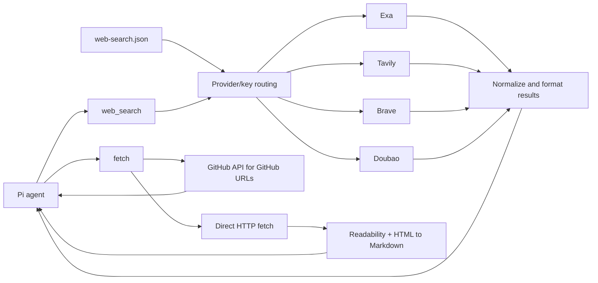

# pi-web-lite

Lightweight web access package for Pi. It registers only two tools:

- `web_search` — search with Exa, Tavily, Brave Search, and Doubao Search
- `fetch` — fetch URLs, convert HTML to Markdown, and optionally extract main content

No curator UI, no browser cookie access, no Gemini/Perplexity, no video analysis, no background servers, no storage cache, and no browser runtime required. HTML processing uses Turndown, its GFM plugin, Mozilla Readability, and Linkedom.

## Architecture



`balanced` mode shuffles every provider/key pair in one pool. `auto` preserves provider priority while rotating keys inside each provider. Failed targets fall through to the next target in the generated plan.

## Configuration

`pi-web-lite` reads **only** the new format at `~/.pi/web-search.json`:

```json
{
  "provider": "balanced",
  "providers": ["exa", "tavily", "brave", "doubao"],
  "apiKeys": {
    "exa": ["exa-key-1"],
    "tavily": ["tavily-key-1", "tavily-key-2"],
    "brave": ["brave-key-1", "brave-key-2"],
    "doubao": ["doubao-key-1"]
  },
  "search": {
    "numResults": 5,
    "timeoutMs": 20000
  },
  "fetch": {
    "timeoutMs": 20000,
    "maxChars": 30000,
    "extractMainContent": true
  }
}
```

Legacy fields are intentionally rejected:

- `exaApiKey`, `exaApiKeys`
- `tavilyApiKey`, `tavilyApiKeys`
- `braveApiKey`, `braveApiKeys`
- `doubaoApiKey`, `doubaoApiKeys`
- `loadBalancing`, `workflow`, `geminiApiKey`, `perplexityApiKey`

## Provider modes

### `balanced`

Flattens every provider+key pair into one pool and shuffles it per search.

Example:

```json
{
  "provider": "balanced",
  "providers": ["exa", "tavily", "brave", "doubao"],
  "apiKeys": {
    "exa": ["exa1"],
    "tavily": ["tvly1", "tvly2"],
    "brave": ["brave1", "brave2"],
    "doubao": ["doubao1"]
  }
}
```

Targets:

```text
exa:exa1
tavily:tvly1
tavily:tvly2
brave:brave1
brave:brave2
doubao:doubao1
```

Each target has equal probability.

### `auto`

Uses `providers` as the priority order. Keys within the same provider are shuffled.

```json
{
  "provider": "auto",
  "providers": ["tavily", "exa", "brave", "doubao"]
}
```

This tries all Tavily keys first, then Exa keys, then Brave keys.

### Direct provider

```json
{ "provider": "brave" }
```

Only Brave keys are used. No fallback to other providers.

## Tools

### `web_search`

```json
{
  "query": "React 19 compiler pitfalls"
}
```

or:

```json
{
  "queries": [
    "React 19 compiler performance",
    "React 19 compiler migration pitfalls"
  ]
}
```

Provider, key, and result count are chosen by config only. The result includes a hashed `keyId` such as `tavily#12ab34cd` so you can verify balancing without leaking API keys.

### `fetch`

```json
{
  "url": "https://github.com/GATE"
}
```

or:

```json
{
  "urls": ["https://example.com", "https://github.com/owner/repo"]
}
```

`fetch` does not use AI analysis or a third-party extraction API.

HTML pages are converted locally to Markdown, preserving headings, links, images,
lists, quotes, code blocks (including indentation), and tables. Relative links and
image URLs are resolved using the final URL after redirects and any HTML `<base>`.
Unsafe link schemes, scripts, styles, and hidden elements are removed. Simple
tables become GFM tables; merged cells are flattened rather than reproducing
`rowspan`/`colspan` layout. Non-HTML content (Markdown, plain text, JSON, XML)
and the existing GitHub API/raw-file paths are returned without conversion.

`fetch.extractMainContent` defaults to `true`: Mozilla Readability tries to isolate
the main article and remove navigation/footer noise. If it returns no usable
content or throws, conversion falls back to the cleaned whole page. Extraction
is heuristic and may omit content on non-article pages; disable it to inspect
navigation, indexes, or a page whose extraction is incomplete:

```json
{
  "url": "https://example.com/docs",
  "extractMainContent": false
}
```

The per-call option overrides the config default and applies to all URLs in a
batch. `details.results[].extractedMainContent` indicates whether extraction
succeeded for HTML pages. Truncation happens after Markdown conversion.

HTTP fetch and DOM parsing **do not execute JavaScript** or load subresources.
Client-rendered pages may therefore return little content. No browser or external
rendering service is included.

GitHub URLs use the GitHub API for stable extraction:

- `https://github.com/org` — organization/user repositories
- `https://github.com/org/repo` — repo metadata + README
- `https://github.com/org/repo/blob/ref/path` — raw file content

## Install

Install from npm:

```bash
pi install npm:pi-web-lite
```

Git and local development alternatives:

```bash
pi install git:github.com/smithyyang/pi-web-lite
pi --no-extensions -e ./src/index.ts
```

Disable/remove the old `pi-web-access` package first if both register `web_search`.

## License

MIT — see [LICENSE](./LICENSE).
